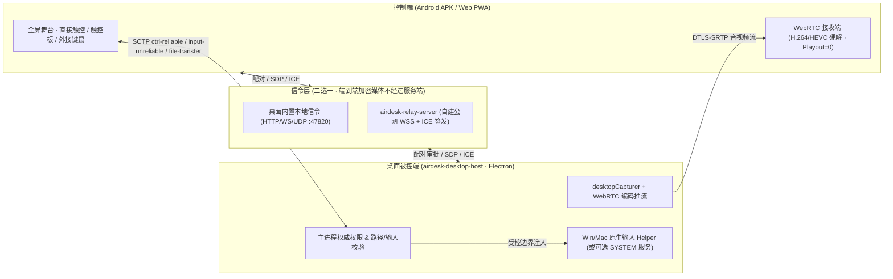

# AirDesk

<p align="left">
  
  
  
  
</p>

**AirDesk** 是一款面向个人自用与开源社区的**超低延迟跨端屏幕串流与远程桌面控制工具**，基于 WebRTC（H.264 / H.265 硬编硬解协商、零缓冲 Playout 控制）与原生 OS 输入注入构建，支持**局域网 / 手机热点 / USB 有线 0 流量直连**、**Tailscale / ZeroTier 异地组网直连**与**自托管公网 WSS + STUN/TURN 中继穿透**。

> **当前版本与实测边界说明（诚实披露）**
> - **当前公测版本**：`v0.8.1`（Desktop Host `v0.5.15` · Android APK `v0.7.5` · Relay Server `v1.0.0`）
> - **已真机实测**：局域网 Wi-Fi 与手机热点直连（含触控板模式、直接触控、双向文件传输、窗口切换无残影优化）均已完成真机实测。
> - **待社区共同验证**：自托管公网中继链路（`airdesk-relay-server` + STUN/TURN）已通过协议级 6 项自动化冒烟测试，尚未经过大规模公网真实 NAT 环境长时压测；**不引入虚拟显示器驱动（VDD）**，依赖真实连接显示器（或硬件显卡欺骗器）进行屏幕采集。

---

## 核心特性

- **三种网络模式无缝切换**：
  1. **局域网 / 手机热点 / USB 有线直连**：桌面端内置 HTTP/WS/UDP（默认端口 `47820`）发现与信令服务，**0 蜂窝流量、无需公网服务器**；Android 原生绕过 `ConnectivityManager` 限制直接枚举系统网卡，支持热点 `wlan2` / `ap0` 与 USB `rndis0` / `adb reverse`。
  2. **异地组网直连（Tailscale / ZeroTier）**：精确识别 `100.64.0.0/10` / `fd7a:115c:a1e0:*` 隧道地址并隔离代理工具虚拟网卡，保持 P2P 低延迟直连。
  3. **自托管公网中继（WSS + STUN/TURN）**：零数据库轻量 Node.js 信令服务，支持访问口令门禁、`coturn` 动态短期 HMAC 凭证签发与 IP 限流防爆破。
- **超低延迟音视频与触控调优**：
  - 强制协商 `playout-delay` RTP 扩展（`min=0, max=0`）与 `WebRTC-VideoRateControl` 高突发 Pacer；
  - 优先协商 H.264 Constrained Baseline（`42e01f`）与可选 H.265/HEVC 硬编硬解，自动探测软编回退并自适应切换 `contentHint`；
  - 串流期间自动抑制 Windows 窗口最大化/还原渐变动画（断开即恢复），避免大面积过渡动画导致的残影与瞬时丢帧；
  - 触控板模式提供本地即时视觉准星与电脑端鼠标坐标校验回传；直接触控支持零延迟落指、长按右键、拖拽与双指滚轮，另支持外接实体鼠标 `Pointer Capture` 锁定透传。
- **双向文件传输 & 实用控制能力**：
  - 支持基于 WebRTC `file-transfer` DataChannel（双向 16KB 分片背压流控，最高 500MB）与局域网 HTTP 快传（Android 端安全落盘 `Download/AirDesk`）；
  - 按需桌面音频同步（免密无缝重协商）、多显示器切换、剪贴板手动/自动同步、7 天免密可信设备管理与急停断权释放全按键。
- **纵深安全边界**：
  - 6 位动态配对码（30 分钟过期 + 连续 5 次错误自动轮换 + IP 限流）；
  - 可选 Windows `NT AUTHORITY\SYSTEM` 后台输入服务通过受限命名管道 + `pipe.secret` 随机密钥 + Console Session 校验访问（支持跨桌面/Ctrl+Alt+Del SAS，普通模式仍保持零管理员门槛）。

---

## 系统架构



---

## 连接模式对比

| 连接方式 | 是否需要公网服务器 | 典型端到端延迟 | 适用场景 |
| :--- | :---: | :---: | :--- |
| **局域网 / 手机热点 / USB 有线** | 不需要（内置 `47820`） | 极低（局域网/热点直连） | 同房间无线副屏、无外网环境、USB-C 线稳态操控 |
| **Tailscale / ZeroTier 异地直连** | 不需要中继自建 | 低～中（取决于 P2P 打洞） | 已搭建私人虚拟局域网的跨城远程访问 |
| **自托管公网 WSS + STUN/TURN** | 需要自部署 `airdesk-relay-server` | 低～中（P2P 直连或 TURN 兜底） | 无固定公网 IP 的 4G/5G 手机访问家里/公司电脑 |

---

## 快速上手

### 1. 桌面被控端（`airdesk-desktop-host`）

> 运行环境要求：Node.js 18+（Windows 需系统自带 .NET Framework 4.x `csc.exe`；macOS 需 Xcode Command Line Tools `swiftc`）。

```bash
cd airdesk-desktop-host
npm install
npm run prebuild:win   # macOS 请改为 npm run prebuild:mac
npm start
```

打包独立安装包（Windows NSIS / macOS DMG）：

```bash
cd airdesk-desktop-host
npm run build:win      # 或 macOS: npm run build:mac
```

> **Windows 局域网/热点直连必看**：首次开启内置 `47820` 服务时，Windows 防火墙若拦截了**「公用网络」**（手机个人热点默认被识别为公用网络），请点击界面上的「一键放行端口 47820」或在系统防火墙中放行 TCP/UDP `47820`。

### 2. Android 控制端（`airdesk-android`）

- 普通用户可直接前往 [Releases](https://github.com/andabaoyue/AirDesk/releases) 下载 `airdesk-v*-arm64-v8a.apk` 安装；也可以在手机浏览器直接访问桌面端提供的内置 PWA 网页作为兜底方案。
- 开发者本地构建（Flutter Stable + JDK 17 + Android SDK）：

```bash
cd airdesk-android
flutter pub get
flutter analyze
flutter build apk --release --split-per-abi --target-platform android-arm64
```

### 3. 自托管公网中继（`airdesk-relay-server`，可选）

```bash
cd airdesk-relay-server
cp .env.example .env   # 按需配置 RELAY_ACCESS_KEY / STUN / TURN
docker compose up -d --build
```

完整反代（Caddy/Nginx WSS）与 `coturn` 配置请见 [公网中继自建指南](docs/self-hosting.md)。

---

## 仓库目录结构

| 目录 / 文件 | 说明 | 文档 |
| :--- | :--- | :--- |
| [airdesk-desktop-host/](airdesk-desktop-host) | Electron 桌面被控端 + Win/Mac 原生输入 Helper + 内置本地信令 | [桌面端说明](airdesk-desktop-host/README.md) |
| [airdesk-android/](airdesk-android) | Flutter + 原生 Kotlin Android 客户端 | [Android 端说明](airdesk-android/README.md) |
| [airdesk-relay-server/](airdesk-relay-server) | 独立无数据库公网 WebSocket 信令与 STUN/TURN 凭证服务 | [中继端说明](airdesk-relay-server/README.md) |
| [docs/](docs) | 系统架构、自建中继部署、防火墙与硬件编解码排障指南 | [架构文档](docs/architecture.md) · [排查指南](docs/troubleshooting.md) |
| [SECURITY.md](SECURITY.md) | 安全架构、威胁模型、UAC 边界与漏洞上报方式 | [安全说明](SECURITY.md) |
| [CONTRIBUTING.md](CONTRIBUTING.md) | 贡献规范与三端本地校验命令 | [贡献指南](CONTRIBUTING.md) |

---

## Bug 反馈与社区交流区

本项目当前处于公测阶段（特别是**公网中继与跨网 NAT 穿透**、**不同显卡驱动与 Android 机型的硬编硬解兼容**），非常欢迎提交真机测试结果与问题反馈：

* **Bug 提交（结构化反馈表）**：[提交 Bug Issue](https://github.com/andabaoyue/AirDesk/issues/new?template=bug_report.yml)（请尽可能附上手机端左上角 HUD 遥测截图、操作系统/手机型号与复现步骤）
* **功能建议与体验优化**：[提交 Feature Request](https://github.com/andabaoyue/AirDesk/issues/new?template=feature_request.yml)
* **使用答疑 / 实测成绩交流**：[GitHub Discussions](https://github.com/andabaoyue/AirDesk/discussions)
* **安全漏洞私密披露**：请勿直接发公开 Issue，请参阅 [SECURITY.md](SECURITY.md)

---

## 开源协议

本项目基于 [MIT License](LICENSE) 开源。
